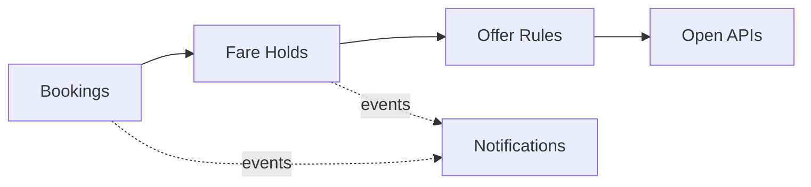

# Domain Model and Bounded Contexts

Ubiquitous language and context design (view VP-4). Domain-standard concepts are mapped
normatively in `../domain/domain-standards.md` (CR-5).

## Ubiquitous language (selected terms)

| Term | Meaning |
|---|---|
| **Booking** | A flight, hotel, package or cruise booking; its PNR is masked |
| **Fare hold** | A booking's guarded held amount, in minor units |
| **Fare charge** | One charge against the hold (fare, taxes, fees, ancillary) |
| **Offer rule** | A decision rule binding a cabin class to discount and stopover envelopes |
| **Travel property** | A hotel, resort, apartment or hostel in the catalogue |
| **Disruption risk score** | A transparent 0-100 weather/congestion/action risk score |

## Bounded contexts and invariants

### Bookings — `booking-service`
Booking registry; the PNR is masked at creation and never kept in clear. Lifecycle: `HELD` → transitions
confirm, cancel. Booking references (PNR) are validated at creation and never stored or returned in clear — only a masked form is kept. Traveler personal and document data is never stored by this core; all data is synthetic. Card data stays with certified PSPs.

### Fare Holds — `fare-hold-service`
Guarded fare holds per booking and the charges against them. **Invariant (ADR-0004): charges against a booking's held amount never exceed that hold — a charge that would overrun it is rejected (422) and records nothing; a booking's money is always exactly accounted.** Consumption records are
append-only evidence; a rejected operation records nothing.

### Offer Rules — `offer-rules-service`
Decision rules binding cabin classes to discount and stopover envelopes. Only ACTIVE rules decide; evaluation order is by priority; every decision
is ALLOWED / DEGRADED / DENIED with the matched rule and a human-readable reason.

### Travel Properties — `travel-property-service`
Travel property catalogue (hotels, resorts, apartments, hostels).

### Notifications — `notification-service`
Delivery trail for audit; recipients are never logged.

## Context map

